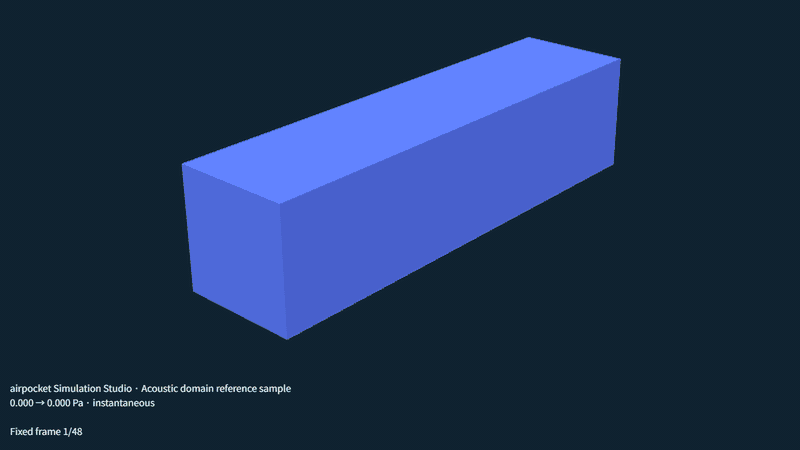
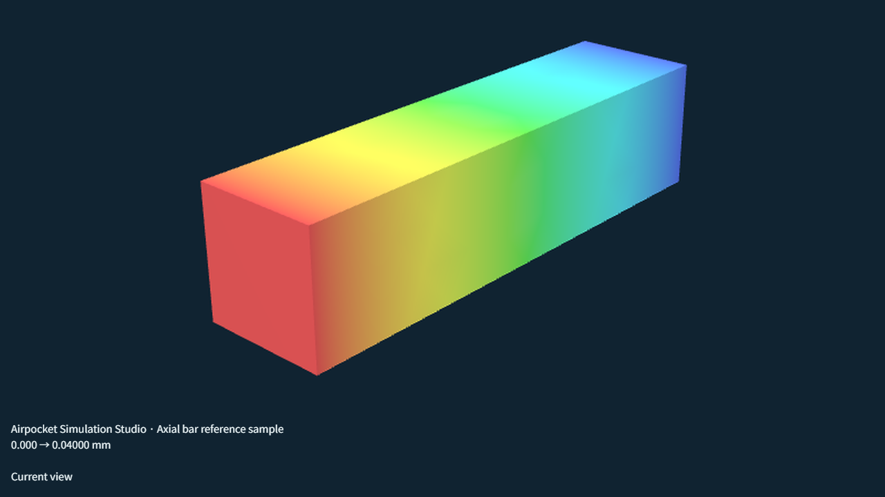
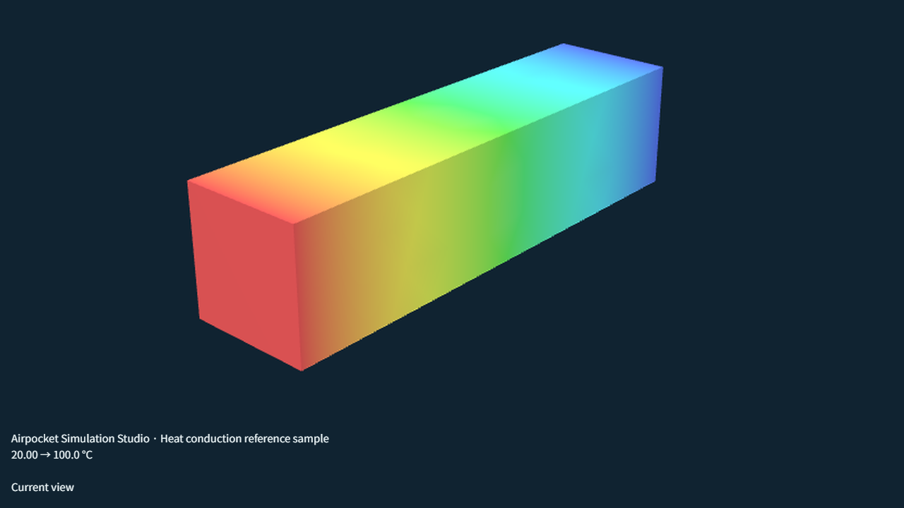
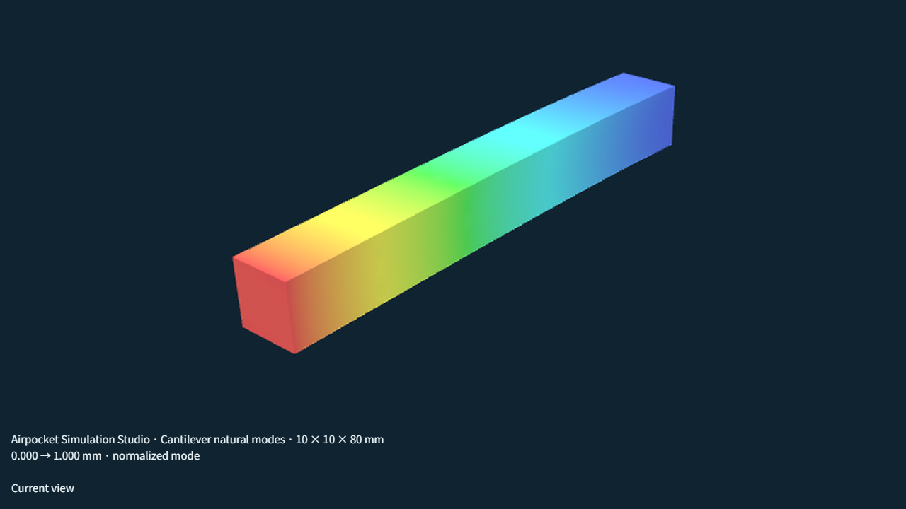
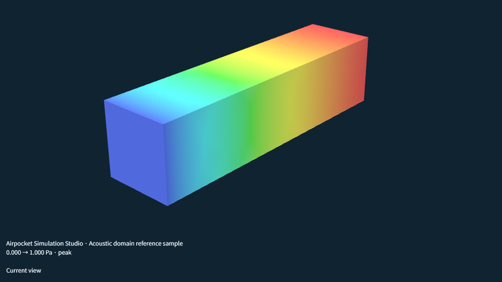

# airpocket Simulation Studio

[English](README.md)

**ブラウザで動くCAEワークベンチ。** STEPやSTLを読み込み、3D画面上で領域を直接選び、構造・熱・流体・振動・音響の解析をローカルで実行します。メッシュ生成と計算はブラウザ（Web Worker + WASM）内で行い、モデルデータは送信されません。

- **アプリを開く:** <https://airpocket-soundman.github.io/airpocket-simulation-studio/>
- **開発管理ボード:** <https://airpocket-soundman.github.io/airpocket-simulation-studio/development.html>



## できること

下の画像は、アプリ内蔵のデモモデルをアプリ自身で解析して書き出した結果です。

| | |
|---|---|
|  **構造** — 線形弾性、指定変位、熱応力、J2塑性、Neo-Hookeanゴム |  **熱** — 定常/非定常熱伝導、対流、放射、接触熱抵抗 |
|  **固有振動** — モード形状と固有振動数 |  **音響** — 周波数領域・過渡、外部放射、指向性、WAV出力 |

動画版: [構造(GIF)](docs/media/structural.gif) · [固有振動(GIF)](docs/media/modal.gif) · [過渡音響(GIF)](docs/media/transient.gif) · WebMは [docs/media](docs/media/) にあります。

### 機能一覧

| 分野 | 対応内容 |
|---|---|
| 形状 | STEP・組込み形状、閉鎖した単一凸STLの体積メッシュ。CADの面全体、平面矩形、円筒領域、三角形単位で選択 |
| 構造 | 線形弾性、指定変位、熱応力、微小ひずみJ2塑性、圧縮性Neo-Hookean、S–N疲労評価、脆性破壊評価 |
| 熱 | 定常/非定常熱伝導、対流、熱放射、平面接触熱抵抗 |
| 流体 | 定常3D低Reynolds数Stokes流（P1とTaylor–Hood P2/P1）、CADからの内部流体抽出、十分発達した層流流路 |
| 振動・音響 | 周波数/過渡音響、固有振動、振動から音への一方向連成、外部放射・指向性 |
| メッシュ | 局所/適応細分化と収束診断 |
| 結果 | 断面表示、点測定、ケース比較、PNG・アニメーション出力 |
| 材料 | 公開樹脂物性91件を含む材料ライブラリ。温度・速度・方向依存と直交異方性に対応 |
| 自動化 | MCPサーバと専用skillで、AIエージェントが同じ操作を実行可能 |
| 3Dプリント | 3MF/G-code読込と層ごとの確認（試験機能） |

ソルバー: 自作のTet4系ソルバー（CPU。構造は試験的なWebGPU + CPU補正あり）と、独立した **MFEM 4.10 WASM** エンジン（構造）を選べるため、結果を相互に確認できます。

## 正直な制限

認証済みソルバーではなく、設計検討の補助です。数値を使う前に制限を確認してください。

- Stokes流のみ: Re≤0.1、外部直方体領域、最大2000節点・8000四面体。慣性・乱流なし。
- STLメッシュ: 外向きの単一閉鎖凸殻、最大2000三角形。自動修復なし。
- J2塑性はCPUエンジン専用。MFEM・WebGPU・適応解析・固有振動・熱応力とは併用できません。
- 疲労評価には、出典付きの完全両振りS–N実測データが必須。材料名だけでは寿命値を出しません。
- 未対応: 一般Navier–Stokes流・乱流、き裂進展、機械的接触、ほぼ非圧縮のゴム、一般曲面/双方向の音響連成。

詳細: [使い方と対応範囲](docs/analysis-guide.md) · [塑性](docs/plasticity.md) · [疲労](docs/fatigue.md) · [Stokes流](docs/stokes-flow.md) · [STLメッシュ](docs/stl-meshing.md)

## クイックスタート

公開アプリを使うか、ローカルで実行します（Node.js 24）。

```bash
npm ci
npm run build
npm run dev      # http://127.0.0.1:5173
npm test         # 全テスト
```

`main` へのpushはGitHub Actionsがビルド・検証し、GitHub Pagesへ公開します。

## AIエージェントから操作する

`npm run mcp` でローカルのstdio [MCP](https://modelcontextprotocol.io/)サーバが起動します（保存済みプロジェクトの確認・編集・事前検査・解析・出力）。ローカルブリッジ経由で開いているブラウザのタブにも接続できます。skillは [skills/airpocket-studio](skills/airpocket-studio/SKILL.md) にあります。[MCPと専用skill](docs/automation.md)。

## ドキュメント

| 分類 | ページ |
|---|---|
| まず読む | [実装する機能](docs/features.md) · [使い方と対応範囲](docs/analysis-guide.md) · [ソルバー](docs/solvers.md) · [材料](docs/materials.md) |
| 構造 | [塑性](docs/plasticity.md) · [ゴム](docs/hyperelasticity.md) · [疲労](docs/fatigue.md) · [脆性破壊](docs/brittle-fracture.md) · [直交異方性材料](docs/orthotropic-materials.md) |
| 流体 | [Stokes流](docs/stokes-flow.md) · [外部流体領域](docs/fluid-domains.md) · [CADから内部流体](docs/internal-fluid.md) |
| 振動・音響 | [音響](docs/acoustics.md) · [過渡音響](docs/transient-acoustics.md) · [外部放射](docs/exterior-acoustics.md) · [固有振動](docs/modal-analysis.md) · [振動から音へ](docs/vibration-acoustics.md) |
| 形状・メッシュ | [STLメッシュ](docs/stl-meshing.md) · [適応メッシュ](docs/adaptive-meshing.md) · [CAD更新](docs/cad-update.md) · [平面](docs/planar-regions.md)/[円筒](docs/cylindrical-cad.md)/[斜め平面](docs/oblique-planar.md)の領域 |
| 結果 | [断面と測定](docs/result-sections.md) · [画像・アニメーション出力](docs/visual-export.md) |
| エンジン | [WebGPU](docs/webgpu.md) · [MFEMエンジン](docs/native-solvers.md) · [ブラウザ実行設計](docs/browser-runtime.md) |
| 3Dプリント | [3MF・G-code読込](docs/printing-import.md) · [3Dプリント部品](docs/printed-parts.md) |
| プロジェクト | [構成](docs/architecture.md) · [開発順序](docs/roadmap.md) · [APIと検証](docs/testing.md) · [整合性レビュー](docs/development-review.md) |

## 進捗と状態

公式の進捗は [`src/progress.json`](src/progress.json) で管理し、[開発管理ボード](https://airpocket-soundman.github.io/airpocket-simulation-studio/development.html)に表示します。状態は区切りごとに更新し、公開記録がある項目だけを「公開済み」と数えます。ボードのメモは各ブラウザにのみ保存され、JSONで書き出せます。

## ライセンスと外部ソフトウェア

[LICENSE](LICENSE) と [THIRD_PARTY.ja.md](THIRD_PARTY.ja.md)（任意のSU2の表示を含む）を参照してください。ソースリポジトリは所有者の指示で公開しています。

*`docs/media` のメディアはChrome上のアプリから撮影しました。作り方は [media-manifest.json](docs/media/media-manifest.json) に記録しています。画像内の字幕には以前の表記「Airpocket」が残っています。*
