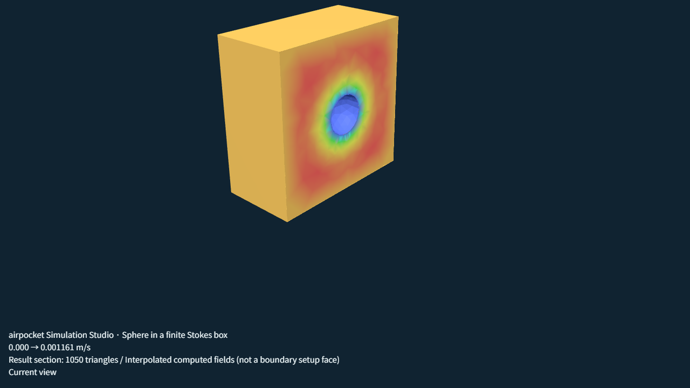
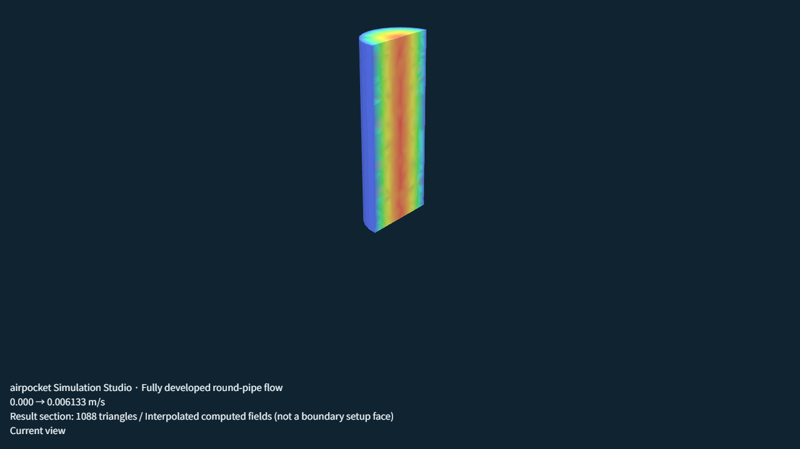

# airpocket Simulation Studio

[日本語](README.ja.md)

**A browser-based CAE workbench.** Load a STEP or STL model, pick regions directly on the 3D view, and run structural, thermal, fluid, vibration and acoustic simulations locally. Meshing and solving run in your browser (Web Worker + WASM). Your model data is not uploaded.

- **Open the app:** <https://airpocket-soundman.github.io/airpocket-simulation-studio/?lang=en>
- **Development board:** <https://airpocket-soundman.github.io/airpocket-simulation-studio/development.html?lang=en>


## What it can do

Each tile is a result produced by the app itself from its built-in demo models.

| | |
|---|---|
|  **Structural** — linear elasticity, prescribed displacement, thermal stress, J2 plasticity, Neo-Hookean rubber |  **Thermal** — steady and transient conduction, convection, radiation, contact resistance |
|  **Natural vibration** — mode shapes and frequencies |  **Acoustics** — frequency-domain and transient, exterior radiation, directivity, WAV output |
|  **Fluid** — Stokes flow around a sphere (half section) |  **Channel flow** — developed laminar speed profile |

Animated versions: [structural (GIF)](docs/media/structural.gif) · [modal (GIF)](docs/media/modal.gif) · [transient acoustics (GIF)](docs/media/transient.gif) · [Stokes flow (GIF)](docs/media/stokes.gif) · WebM clips are in [docs/media](docs/media/).

### Feature overview

| Area | Support |
|---|---|
| Geometry | STEP and built-in shapes; closed single convex STL volume meshes. Select whole CAD faces, planar rectangles, cylindrical patches, or triangles |
| Structure | Linear elasticity, prescribed displacement, thermal stress, small-strain J2 plasticity, compressible Neo-Hookean, S–N fatigue screening, brittle-fracture screening |
| Thermal | Steady/transient conduction, convection, radiation, planar contact resistance |
| Fluid | Steady 3D low-Reynolds Stokes flow (P1 and Taylor–Hood P2/P1), internal fluid extraction from CAD, developed laminar channel flow |
| Vibration / acoustics | Frequency-domain and transient acoustics, natural modes, one-way vibration-to-sound coupling, exterior radiation and directivity |
| Meshing | Local and adaptive refinement with convergence diagnostics |
| Results | Section views, probes, case comparison, PNG/animation export |
| Materials | Built-in library including 91 published polymer records, with temperature/rate/direction dependence and orthotropic data |
| Automation | MCP server and a dedicated skill so an AI agent can drive the same operations |
| Printing | 3MF / G-code import and layer inspection (experimental) |

Solver engines: the in-house Tet4 solvers (CPU, with experimental WebGPU plus CPU correction for structure) and an independent **MFEM 4.10 WASM** engine for structure, so results can be cross-checked.

## Honest limits

This is an engineering aid, not a certified solver. Read the limits before relying on a number.

- Stokes flow only: Re ≤ 0.1, external box domains, up to 2,000 nodes / 8,000 tetrahedra. No inertia or turbulence.
- STL meshing: one closed, outward-facing, convex shell, up to 2,000 triangles. No automatic repair.
- J2 plasticity runs on the CPU engine only. It cannot be combined with MFEM, WebGPU, adaptation, modal analysis or thermal stress.
- Fatigue needs measured fully reversed S–N data with provenance; material names alone never produce a life value.
- Not supported yet: general Navier–Stokes and turbulence, crack growth, mechanical contact, nearly incompressible rubber, general curved or two-way acoustic coupling.

Details: [Analysis guide](docs/en/analysis-guide.md) · [Plasticity](docs/en/plasticity.md) · [Fatigue](docs/en/fatigue.md) · [Stokes flow](docs/en/stokes-flow.md) · [STL meshing](docs/en/stl-meshing.md)

## Quick start

Use the hosted app, or run it locally (Node.js 24):

```bash
npm ci
npm run build
npm run dev      # http://127.0.0.1:5173
npm test         # full test suite
```

Pushes to `main` are built by GitHub Actions, verified, and published to GitHub Pages.

## Driving it from an AI agent

`npm run mcp` starts a local stdio [MCP](https://modelcontextprotocol.io/) server (inspect, edit, preflight, solve and export saved projects) and can connect to an open browser tab through a local bridge. The skill lives in [skills/airpocket-studio](skills/airpocket-studio/SKILL.md). See [MCP and skill](docs/en/automation.md).

## Documentation

| Topic | Pages |
|---|---|
| Start here | [Features](docs/en/features.md) · [Analysis guide](docs/en/analysis-guide.md) · [Solvers](docs/en/solvers.md) · [Materials](docs/en/materials.md) |
| Structure | [Plasticity](docs/en/plasticity.md) · [Rubber](docs/en/hyperelasticity.md) · [Fatigue](docs/en/fatigue.md) · [Brittle fracture](docs/en/brittle-fracture.md) · [Orthotropic materials](docs/en/orthotropic-materials.md) |
| Fluid | [Stokes flow](docs/en/stokes-flow.md) · [Exterior fluid domains](docs/en/fluid-domains.md) · [Internal fluid from CAD](docs/en/internal-fluid.md) |
| Vibration and acoustics | [Acoustics](docs/en/acoustics.md) · [Transient](docs/en/transient-acoustics.md) · [Exterior radiation](docs/en/exterior-acoustics.md) · [Modal](docs/en/modal-analysis.md) · [Vibration to sound](docs/en/vibration-acoustics.md) |
| Geometry and meshing | [STL meshing](docs/en/stl-meshing.md) · [Adaptive meshing](docs/en/adaptive-meshing.md) · [CAD update](docs/en/cad-update.md) · [Planar](docs/en/planar-regions.md) / [cylindrical](docs/en/cylindrical-cad.md) / [oblique](docs/en/oblique-planar.md) regions |
| Results | [Sections and probes](docs/en/result-sections.md) · [Image and animation export](docs/en/visual-export.md) |
| Engines | [WebGPU](docs/en/webgpu.md) · [MFEM engine](docs/en/native-solvers.md) · [Browser runtime](docs/en/browser-runtime.md) |
| Printing | [3MF / G-code import](docs/en/printing-import.md) · [Printed parts](docs/en/printed-parts.md) |
| Project | [Architecture](docs/en/architecture.md) · [Roadmap](docs/en/roadmap.md) · [Testing](docs/en/testing.md) · [Review notes](docs/en/development-review.md) |

## Progress and status

Official progress is tracked in [`src/progress.json`](src/progress.json) and shown on the [development board](https://airpocket-soundman.github.io/airpocket-simulation-studio/development.html?lang=en). Status is updated at milestones; a task counts as released only when a publication record exists. Notes on the board are stored locally in each browser and can be exported as JSON.

## License and third-party software

See [LICENSE](LICENSE) and [THIRD_PARTY.md](THIRD_PARTY.md) (includes the optional SU2 notice). The source repository is public at the owner's request.

*Media in `docs/media` were captured from the app running in Chrome; [media-manifest.json](docs/media/media-manifest.json) lists how each file was made. Rubber and fatigue demos are not shown because their results are not visually distinct yet.*
